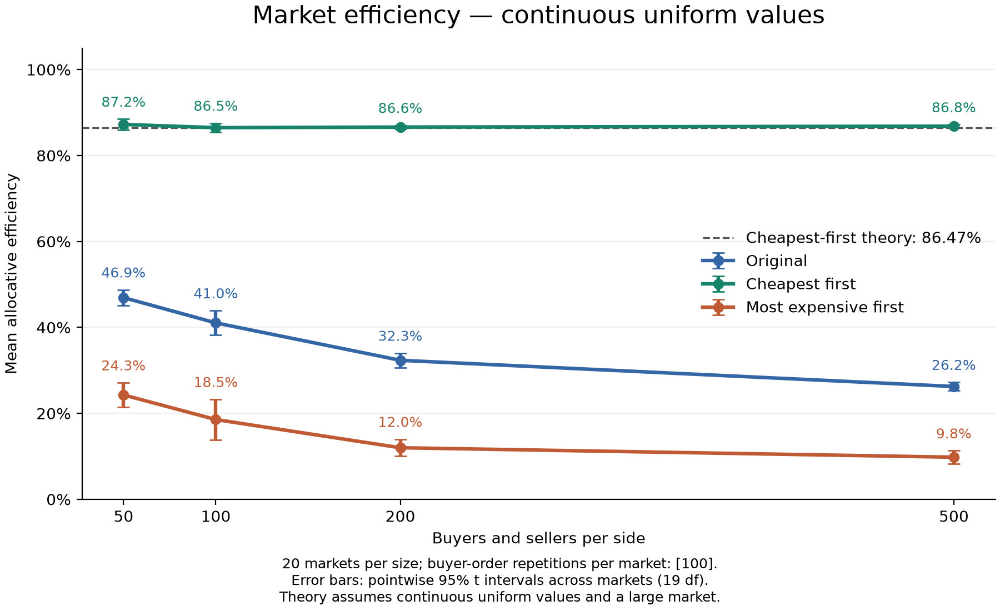

# Market Matching Simulator

How does seller ordering affect gains from trade when buyers arrive randomly and buy the first acceptable item?

This Python research project compares three allocation rules with an optimal-surplus benchmark. It combines simulation, confidence intervals, and a large-market mathematical approximation. It is inspired by game trading markets, but does not use real game data.



## Findings

For continuous uniform valuations and costs, the recorded experiments produced:

| Participants per side | Original | Cheapest first | Most expensive first |
|---:|---:|---:|---:|
| 50 | 46.9% | 87.2% | 24.3% |
| 100 | 41.0% | 86.5% | 18.5% |
| 200 | 32.3% | 86.6% | 12.0% |
| 500 | 26.2% | 86.8% | 9.8% |

Each number is the mean efficiency across 20 markets, with 100 buyer-order shuffles per market. Cheapest-first matching stays near 87%, while the other rules decline over the tested sizes. Integer experiments show the same broad pattern. These observations do not prove asymptotic convergence or that either declining rule converges to zero.

## Setup and commands

Open this project folder in VS Code and open its terminal. Use Python 3.10 or later. If your installation uses `py` instead of `python`, substitute it in these commands.

```console
python -m pip install -r requirements.txt
python -m unittest -v test_market
```

Simulation and tests use only Python's standard library. Matplotlib is needed for graphs.

The existing results can be plotted without rerunning the experiments:

```console
python plot_experiments.py --distribution integer
python plot_experiments.py --distribution continuous
```

Generate all four sizes with the original settings:

```console
python run_experiment.py --distribution integer
python run_experiment.py --distribution continuous
```

Run just one size, or save a graph without opening a window:

```console
python run_experiment.py --distribution continuous --sizes 100
python plot_experiments.py --distribution continuous --sizes 100 --no-show
```

`run_experiment.py` accepts `--sizes`, `--markets`, and `--orders`. Defaults are 50/100/200/500, 20, and 100 respectively. Larger runs take longer. The current plotting script deliberately requires exactly 20 markets because its t critical value is fixed at 19 degrees of freedom. Do not change the market count for a plotted comparison without updating the interval calculation.

## Files

| File | Purpose |
|---|---|
| `market.py` | Shared trading rules and optimal-surplus benchmark |
| `run_experiment.py` | Reproducible experiment runner for either distribution |
| `plot_experiments.py` | Graphs and pointwise 95% confidence intervals |
| `test_market.py` | Automated economic and programming checks |
| `Market_efficiency_report.docx` | Written report |
| `results/` | Integer experiment CSVs and figures |
| `results_continuous/` | Continuous experiment CSVs and figures |

New experiment runs create timestamped CSVs rather than overwrite data. Each graph uses the latest timestamped CSV for each requested size and writes a `.sources.txt` file identifying its inputs. Plotting replaces the graph in that distribution's results folder. To reproduce an older graph, retain its listed input files and select those files rather than automatically taking the latest runs.

## Model and definitions

- N buyers and N sellers trade an identical item. Every participant can trade at most once.
- All sellers are available initially. Buyers arrive in a randomly shuffled order.
- Each buyer searches all remaining sellers in the chosen order and takes the first seller with cost strictly below the buyer's valuation.
- A buyer with no acceptable seller leaves permanently. Unsold sellers remain available.
- Original order means the initially generated seller order, held fixed across the buyer shuffles for that market.
- Costs and valuations are independent uniform integers from 1 to 100, or independent continuous uniform draws from 0 to 1.
- A trade creates surplus equal to buyer valuation minus seller cost. No price or surplus split is modelled.

Efficiency is realised surplus divided by optimal surplus. For the benchmark, sort buyers descending and sellers ascending, and sum positive differences of corresponding values. If the optimum is zero, efficiency is undefined: the new runner retains the row with a blank efficiency instead of reporting zero or silently dropping the market. The plotting script flags such data.

CSV rows represent one market and one rule. `average_surplus` and `average_trades` average over buyer shuffles. `surplus_per_trade` divides all realised surplus by all completed trades across those shuffles. Do not confuse this with averaging per-run ratios. `efficiency` is a decimal, so 0.87 means 87%.

## Reproducibility and uncertainty

Market seeds run from 0 to `markets - 1`. Buyer-shuffle seeds are `10000 + market_seed`. All rules face exactly the same buyer orders within each market. Changing between `randint` and `random` changes the generated samples even when seeds match; integer/continuous comparisons are not paired discretisations of identical draws.

Confidence intervals use market-level means: mean plus or minus 2.093024054 times sample standard deviation divided by sqrt(20). They approximate uncertainty in the mean under independent market draws, including finite-shuffle Monte Carlo variability. They are pointwise intervals, not simultaneous confidence bands, and do not cover 95% of individual markets. Comparisons between rules share markets; a formal comparison should use paired market-level differences rather than interpret error-bar overlap as a test.

## Cheapest-first large-market approximation

For continuous uniform values, let t be the fraction of buyers processed and x(t) the fraction of sellers who have traded. The cheapest remaining seller costs approximately x. A buyer trades with probability 1 - x, yielding:

```text
dx/dt = 1 - x,    x(0) = 0
x(t) = 1 - exp(-t)
```

Expected surplus from the next buyer is the integral of (v - x) from x to 1, or (1 - x)^2 / 2. Integrating over t from 0 to 1 gives surplus per initial seller of (1 - exp(-2)) / 4. The optimal surplus per initial seller approaches 1/4. The resulting efficiency approximation is:

```text
1 - exp(-2) = 0.8646647...
```

This fluid argument explains the nearby simulation results; it is not a rigorous convergence proof or an exact finite-market expectation. Cheapest first maximises immediate surplus for the current buyer, not necessarily market-wide surplus or average surplus per trade.

## Validation and limitations

Tests cover one trade per participant, unchanged inputs, skipping an unaffordable seller, empty/no-gain markets, exact two-buyer expectations, seed reproducibility, and agreement between the benchmark and exhaustive allocation search on 729 small markets.

The model omits asking prices, strategic behaviour, search costs, multiple units, and changing demand or supply. Costs are directly available to the matching rule. The findings should not be treated as predictions for a real game economy without further validation.

## Explaining the project

A short description: “I built a Python market simulator to study how seller ordering affects allocative efficiency. I compared three rules across market sizes and distributions, quantified uncertainty across markets, and derived a large-market approximation for cheapest-first matching. The main finding was that higher trade volume need not mean greater gains from trade.”

Before presenting it, be ready to explain why prices cancel from total surplus, why we average over markets rather than count every shuffle as independent, and why the 86.47% approximation does not establish an exact finite-market result.
